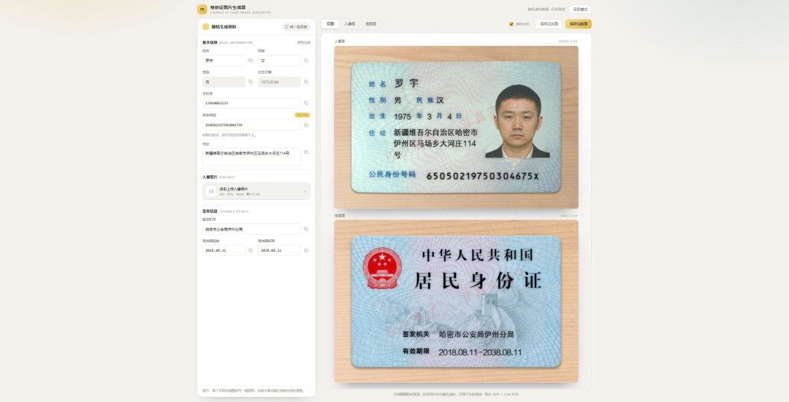

# 身份证图片生成器

**Vue 3 · TypeScript · Vite** ｜ 随机虚构资料 + 真实卡面排版，一键导出身份证正反面图片

[功能特性](#功能特性) · [界面预览](#界面预览) · [快速开始](#快速开始) · [部署到 GitHub Pages](#部署到-github-pages) · [目录结构](#目录结构) · [实现说明](#实现说明)

> **⚠️ 使用声明**
>
> 本项目仅用于软件开发、联调、OCR / 表单校验等**测试场景**。页面内的姓名、号码、住址、手机号全部由程序随机生成，
> **不对应任何真实个人**；生成的图片默认带「仅供测试 · 非真实证件」水印。
> 请勿用于任何非法用途，使用者需自行承担相应责任。

## 界面预览



*左侧编辑资料 · 右侧实时预览 · 双面同屏 · 一键导出 1800 × 1200 JPEG*

## 功能特性

### 资料生成与编辑

- **一键换一组**：随机生成姓名、民族、手机号、住址、签发机关、有效期限与 18 位身份证号
- **合规的随机规则**：姓名两字 39% / 三字 60% / 四字 1%；民族按人口权重抽取；住址约 10% 不含门牌号
- **身份证号合法**：遵循 GB 11643，末位校验码按加权模 11 计算；性别由第 17 位奇偶推导，出生日期取自第 7~14 位
- **有效期限自洽**：按签发时年龄推导 5 / 10 / 20 年或长期，随机出的年份若已过期会自动顺延
- **手机号**：`1` + 在用号段（130~199）+ 8 位随机数，仅作资料展示，不参与卡面渲染
- **人像照片**：支持上传本地图片（≤ 5 MB），同一会话内刷新不丢失；未上传时按性别使用预设真人头像

### 交互与导出

- **实时预览**：修改左侧任意字段，右侧卡面即时更新；可切换「双面 / 人像面 / 信息面」
- **整屏不滚动**：页面锁定 100vh，左侧面板占满视口高度，卡面按可用宽高等比缩放，双面同屏也不出现滚动条
- **逐字段复制**：每个字段右侧都有复制按钮，标题行另有「复制全部」，一次复制整套多行资料
- **导出**：保存当前面或一次性保存正反面，输出 1800 × 1200 JPEG（与原站一致）
- **导出前校验**：号码校验位、手机号、姓名汉字数、签发机关字数、期限格式任一不通过时禁用导出并给出提示
- **深色模式**：跟随系统偏好，可手动切换并记忆

## 快速开始

```bash
# 安装依赖
npm install

# 本地开发（默认 http://localhost:5173）
npm run dev

# 类型检查 + 生产构建
npm run build

# 预览构建产物
npm run preview
```

**环境要求**：Node.js 20+，现代浏览器（Chrome / Edge 最佳）。
卡面文字使用 `background-clip: text`、头像使用 `mask-composite`，导出依赖 `html-to-image` 的 SVG foreignObject 渲染。

## 部署到 GitHub Pages

仓库内置 `.github/workflows/deploy.yml`，推送到 `main` 即自动构建并发布。

首次部署需要在仓库设置里做一步：

1. 打开 **Settings → Pages → Build and deployment**；
2. 把 **Source** 选成 **GitHub Actions**（不要选 Deploy from a branch）。

之后每次推送 `main`，或在 **Actions** 页面手动运行 **Deploy to GitHub Pages** 即可。访问地址为：

```
https://<用户名>.github.io/<仓库名>/
```

工作流要点：

- Node 22 + `npm ci`，先执行 `npm run build`（内置 `vue-tsc` 类型检查，类型错误会中断部署）；
- `dist` 由 `actions/upload-pages-artifact` 上传，再由 `actions/deploy-pages` 发布；
- `vite.config.ts` 在构建时使用 `base: './'`（相对路径），仓库改名、换成 `*.github.io` 站点或绑定自定义域名都无需改配置；
- 同一时间只保留一个部署任务，新提交会自动取消进行中的旧任务。

> 若部署后页面空白，多半是 Pages 的 Source 仍是 “Deploy from a branch”，改成 GitHub Actions 后重新运行工作流即可。

## 目录结构

```
.
├── .github/workflows/       # GitHub Actions 部署工作流（deploy.yml）
├── docs/                    # README 用图
├── src/
│   ├── assets/card/         # 卡面底图、预设头像、印刷字体、噪点纹理
│   ├── components/
│   │   ├── card/            # 卡面 DOM：IdCard（正反面）、HeadPhoto（头像画布）
│   │   ├── ui/              # 通用小组件：CopyButton
│   │   ├── AppHeader.vue    # 顶部栏
│   │   ├── StudioForm.vue   # 左侧资料面板
│   │   └── StudioPreview.vue # 右侧预览与导出
│   ├── composables/         # useTheme 主题切换
│   ├── data/                # 姓氏、民族、行政区划、地址素材
│   ├── renderer/            # 头像噪点 + 低多边形处理
│   ├── styles/              # SCSS 变量、主题、全局样式、卡面版式（id-card.scss）
│   ├── types/               # 类型定义
│   ├── utils/               # 随机工具、号码生成与校验、随机资料、剪贴板、卡面导出
│   ├── App.vue
│   └── main.ts
└── vite.config.ts
```

## 实现说明

### 卡面渲染

- 卡面是**真实 DOM**：以 3600 × 2400 的设计坐标系排版，底图提供木纹桌面、卡面印刷图层（标签、国徽、防伪底纹），
  文字层按底图印刷位置用绝对定位摆放，预览时通过 `transform: scale()` 等比缩小。
- **导出**：`html-to-image` 的 `toJpeg(node, { pixelRatio: 0.5 })` 直接截图 → 1800 × 1200 JPEG；
  字体内嵌样式（约 4.8 MB 的印刷字体）只计算一次并缓存。
- **文字质感**：印刷字体 + `background-clip: text` 叠加噪点纹理 + 多层 `text-shadow` + `blur(1px)`，还原油墨压印的观感。

### 头像处理

预设头像是带透明通道的抠图，绘制到 960 × 1200 画布后：

1. 复制一份做 3px 高斯模糊，逐像素叠加 ±25 的随机噪点；
2. 以 6px 为边长铺满向下三角形，用格子中心色填充，形成低多边形质感；
3. 最后由 CSS 叠加 `blur(1px)`、`opacity: .7` 与边缘羽化 `mask`，让头像像"印"在卡面上。

> 图片加载是异步的，内部用渲染序号丢弃过期请求，避免快速切换性别时头像与信息不一致。

### 资料生成

- **身份证号**：6 位地址码 + 8 位出生日期 + 3 位顺序码 + 1 位校验码，校验位按 GB 11643 加权模 11 计算。
- **住址**：省 / 市 / 区县取自国家统计局行政区划数据，再拼接乡镇街道、道路与门牌号。
- **签发机关**：约 40% 概率落到区县分局（如「北京市公安局朝阳分局」），名称超过 11 字时回退到市级公安局。
- **有效期限**：未满 16 周岁 5 年、16~25 周岁 10 年、26~45 周岁 20 年、46 周岁以上长期。

## 素材与声明

- `src/assets/card` 下的卡面底图、预设头像与印刷字体沿用 [idimg.pages.dev](https://idimg.pages.dev/) 的公开素材，
  仅用于本地测试与学习；如涉及版权问题，请删除或替换为你拥有授权的素材。
- 本项目与任何政府机构无关，生成图片不具备任何法律效力，请勿用于证明身份或任何欺诈用途。
